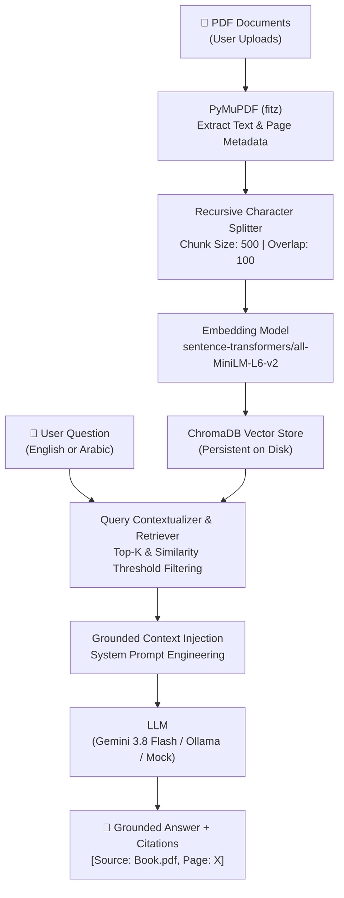

# 📚 AI PDF Assistant — RAG-Based Chatbot

An enterprise-grade, conversational **Retrieval-Augmented Generation (RAG)** system built with **Python 3.11**, **PyMuPDF**, **HuggingFace Sentence Transformers**, **ChromaDB**, **LangChain**, **Google Gemini API**, and **Streamlit**.

Ask questions across multiple PDF documents in **English** or **العربية (Arabic)**, receive strictly grounded answers, and view verifiable **source citations with exact page numbers**.

---

## 🌟 Key Features

1. **Multi-PDF Knowledge Base**:
   - Upload and index multiple PDF files (textbooks, research papers, manuals, reports) simultaneously.
   - Filter queries to a specific document or search seamlessly across all indexed files.

2. **Accurate Page Citations**:
   - Every answer is grounded in retrieved chunks and provides exact citations: `[Source: filename.pdf, Page: X]`.
   - Expandable citation cards with page numbers, relevance similarity scores, and textual excerpts.

3. **Bilingual Arabic & English Support (ثنائي اللغة)**:
   - Full support for English and Arabic prompts, document ingestion, and answers.
   - Automatically adapts response language and preserves Arabic punctuation and terminology.

4. **Conversational Multi-Turn QA & Follow-Ups**:
   - Understands conversational pronouns and follow-ups (e.g., *"What are its types?"*, *"How does it compare to the first approach?"*).
   - Contextualizer reformulates follow-up queries into self-contained search queries for high-precision retrieval.

5. **Executive Document Summarization**:
   - One-click structured summaries for any indexed document highlighting core concepts, main objectives, and conclusions.

6. **Interactive RAG Evaluation Dashboard**:
   - Built-in benchmarking suite testing **Context Precision**, **Keyword Recall**, **Page Hit Rate**, and **Response Latency**.

---

## 🏗️ System Architecture



---

## 🛠️ Tech Stack & Technologies

| Layer | Technology | Role |
| :--- | :--- | :--- |
| **Language** | Python 3.11 | Core runtime environment |
| **Document Processing** | PyMuPDF (`fitz`) | High-speed, accurate text & page number extraction |
| **Chunking** | Custom Recursive Splitter | Context preservation with configurable size & overlap |
| **Embeddings** | HuggingFace (`all-MiniLM-L6-v2`) | Dense 384-dimensional semantic text embeddings |
| **Vector Database** | ChromaDB | Local persistent vector storage and cosine similarity retrieval |
| **Orchestration** | LangChain ecosystem | RAG pipeline coordination and prompt structuring |
| **LLM Provider** | Google Gemini (`gemini-3.8-flash`) / Ollama | Advanced conversational generation and grounding |
| **Frontend** | Streamlit | Responsive, modern web application UI |

---

## 📂 Project Structure

```
AI-PDF-Reader/
│
├── data/
│   └── pdfs/                   # Uploaded and sample PDF documents
│
├── vectorstore/
│   └── chroma_db/              # Persistent ChromaDB vector database
│
├── src/
│   ├── __init__.py
│   ├── document_loader.py      # PyMuPDF PDF parser and page extractor
│   ├── text_splitter.py        # Recursive chunking & metadata preservation
│   ├── embeddings.py           # Sentence-transformers embedding manager
│   ├── vector_store.py         # ChromaDB interface and persistence
│   ├── retriever.py            # Top-K semantic search and similarity filtering
│   ├── rag_pipeline.py         # Grounded prompt synthesis and LLM caller
│   └── chatbot.py              # Multi-turn conversation and query contextualizer
│
├── evaluation/
│   ├── test_questions.json     # Standardized evaluation benchmark cases
│   └── evaluate.py             # Evaluation runner & metric generator
│
├── create_sample_pdf.py        # Generates sample bilingual ML PDF for quick test
├── app.py                      # Main Streamlit web application
├── config.py                   # Centralized configuration and parameters
├── requirements.txt            # Python dependencies
├── .env.example                # Environment variables template
├── .gitignore                  # Git ignore rules
└── README.md                   # Project documentation
```

---

## 🚀 Quickstart & Installation

### 1. Clone the Repository
```bash
git clone https://github.com/<your-username>/AI-PDF-Reader.git
cd AI-PDF-Reader
```

### 2. Create and Activate Virtual Environment
**Windows (PowerShell):**
```powershell
python -m venv .venv
.venv\Scripts\Activate.ps1
```

**Linux / macOS:**
```bash
python3 -m venv .venv
source .venv/bin/activate
```

### 3. Install Dependencies
```bash
pip install -r requirements.txt
```

### 4. Configure Environment Variables
Copy `.env.example` to `.env`:
```bash
cp .env.example .env
```
Add your **Gemini API Key** from [Google AI Studio](https://aistudio.google.com/):
```env
GEMINI_API_KEY=your_actual_gemini_api_key_here
GEMINI_MODEL=gemini-3.8-flash
```
*(Note: You can also enter the API key directly in the Streamlit web sidebar or select Mock mode for local testing).*

### 5. Generate Sample PDF (Optional)
To test immediately without uploading your own PDF:
```bash
python create_sample_pdf.py
```

### 6. Launch the Streamlit App
```bash
streamlit run app.py
```
Open your browser at `http://localhost:8501`.

---

## 🧪 Running the Evaluation Benchmark

To benchmark retrieval precision, keyword recall, and response latency:
```bash
python -m evaluation.evaluate
```
Or click the **▶️ Run Evaluation Benchmark** button in the **📊 RAG Evaluation** tab inside the Streamlit web interface.

---

## 📈 Evaluation Metrics

- **Context Precision**: Evaluates whether retrieved document chunks are directly relevant to the user's inquiry.
- **Context Recall**: Measures whether all necessary facts and keywords needed to formulate the answer were successfully retrieved.
- **Page Hit Rate**: Verifies whether the retriever located the exact target page containing the definitive answer.
- **Response Latency**: Measures end-to-end execution time from query receipt to final rendered answer.

---

## 💡 Example Interaction

**User:**
> "What is the difference between supervised and unsupervised learning?"

**AI Assistant:**
> **Supervised learning** is trained on labeled datasets where each input is mapped to an expected target outcome (such as classification and regression) `[Source: machine_learning_basics.pdf, Page: 1]`.
>
> In contrast, **unsupervised learning** works with unlabeled data to discover hidden patterns and groupings without human intervention (such as clustering and dimensionality reduction) `[Source: machine_learning_basics.pdf, Page: 1]`.

**User (Follow-up):**
> "What are the common evaluation metrics for the first one?"

*(The system automatically contextualizes the query to "What are the common evaluation metrics for supervised classification models?")*

**AI Assistant:**
> For supervised classification models, key evaluation metrics include:
> - **Accuracy**: Proportion of correct predictions over total predictions.
> - **Precision**: True positives over predicted positives (TP / (TP + FP)).
> - **Recall**: True positives over actual positives (TP / (TP + FN)).
> - **F1-Score**: Harmonic mean of precision and recall.
> - **ROC-AUC**: Discriminative power across decision thresholds.
>
> `[Source: machine_learning_basics.pdf, Page: 2]`

---

## 🛡️ License
Distributed under the MIT License.
